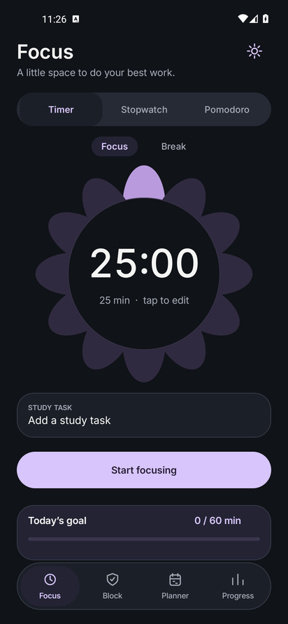
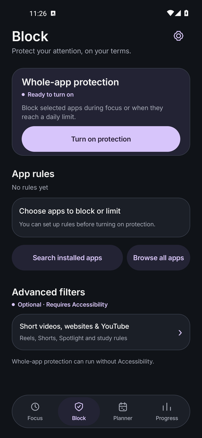
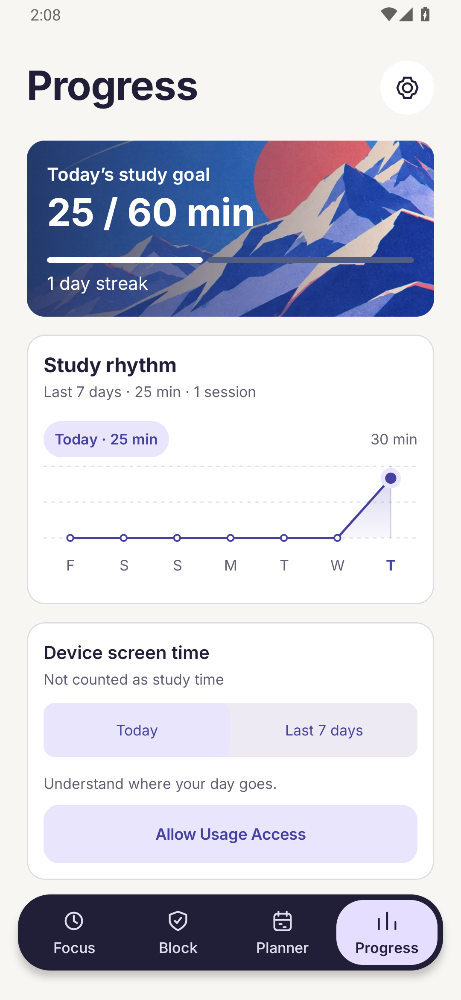

# StudyOrbit

StudyOrbit is an offline Android app for focus sessions and distraction blocking. It uses Kotlin and Jetpack Compose and does not require an account.

- Run a countdown, stopwatch, or Pomodoro cycle with focus sounds, timer notifications, and a floating timer on supported devices.
- Set app limits, block short-video feeds, or keep a list of websites and YouTube channels for studying.
- Plan one-time or repeating study sessions, and review study history and screen time.
- Add the **Focus timer** or **Next study session** widget from the Android home-screen widget picker under StudyOrbit.

Whole-app protection uses Android Usage Access and Display over other apps. Enable it from the Block tab. Advanced filters for short-video feeds, websites, and YouTube channels use optional Accessibility and depend on what each app exposes. Usage Access is also needed for screen-time reports.

## Download

Get the optimized APK from the [latest GitHub release](https://github.com/truepushkar/studyorbit/releases/latest).

## Screenshots

| Focus | Block | Planner | Progress |
| --- | --- | --- | --- |
|  |  |  |  |

## Build

Use JDK 17 and Android SDK Platform 35. The app supports Android 8.0 and later.

| Build | macOS / Linux | Windows |
| --- | --- | --- |
| Debug | `./gradlew assembleDebug` | `.\gradlew.bat assembleDebug` |
| Optimized for local install | `./gradlew assembleOptimized` | `.\gradlew.bat assembleOptimized` |

The optimized build uses R8 and the local Android debug signing key.

The bundled adult-domain list comes from [The Block List Project](https://github.com/blocklistproject/Lists), which releases it under [the Unlicense](https://github.com/blocklistproject/Lists/blob/main/LICENSE).
